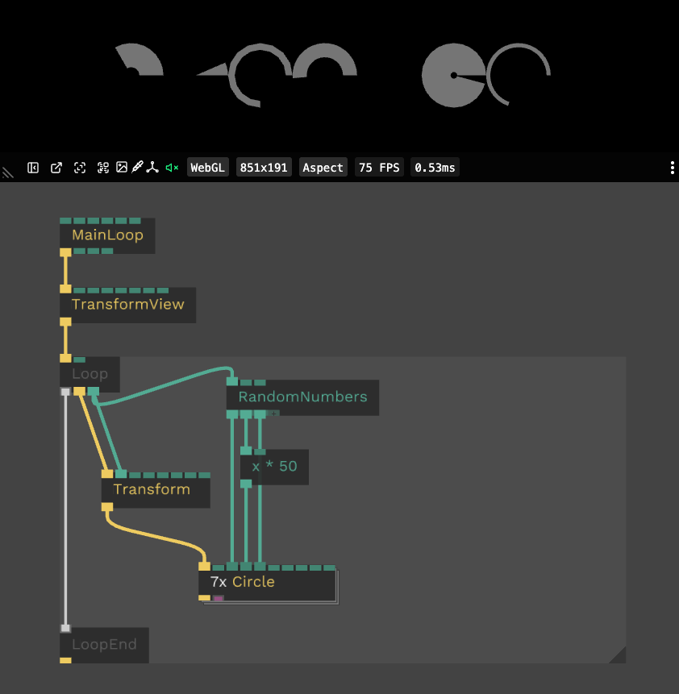

# Loops and Stacking

Sometimes you need the same thing many times: 100 cubes, 20 lights, a grid of images.
Instead of copying ops, you can use a `Loop` to repeat them....

## Try it yourself

Open the example patches and explore them: change `Count`, turn stacking on and off and see what happens.

[Loop and stacking example patches](https://dev.cables.gl/patchlist/HsMhlz)

## The Loop op

- `Loop` runs everything inside its gray area `Count` times
- `Index` is the number of the current iteration: 0, 1, 2 ... `Count - 1`
- Use `Index` to make each iteration different, for example to move each object further to the right
- `Loop2d` outputs `X` and `Y` for grids

A loop runs the ops inside it once per iteration, one after another. There is only **one instance** of each op, and all iterations share it.
For most ops this is fine. For some it is not, and that is what stacking is for.

## Stacking

Select an op inside the loop and switch on "Loop stack op" in the op panel

### Example

Stacking duplicates an op for every iteration of the loop, so each iteration has its own instance.

In this case the circle op is stacked. Without stacking in every frame every circle mesh would be generataed again. With stacking every circle has its own mesh and it stays the same until changed.

## Performance Tip

Check the Performance op and compare the CPU time with and without stacking.

## When to stack an op

### Expensive ops: stacking is a cache

Each copy keeps its own inputs and results, and only recalculates when **its own** inputs change.

Without stacking, a single op receives different values in every iteration, so it may recalculate every iteration of every frame.
With stacking, the inputs of each copy stay the same, so nothing is recalculated until a value actually changes.

This matters for ops that generate meshes, fill large arrays or create textures, and for subpatches that do this.
Without stacking, a loop that draws 20 different meshes rebuilds all 20 every frame. With stacking, each mesh is built once, and only a mesh whose settings change is rebuilt.

### Ops that create something

Ops that create an HTML element, a texture, a mesh or another resource.
Without stacking there is only one of it, shared by all iterations. With stacking, each iteration gets its own.

## When not to stack

- Ops that only draw or transform, like `Transform` or `Cube`: they run in every iteration anyway
- Simple math on `Index`, like `Index * 2`
- Every copy uses memory and runs its own code, so only stack ops that need it
