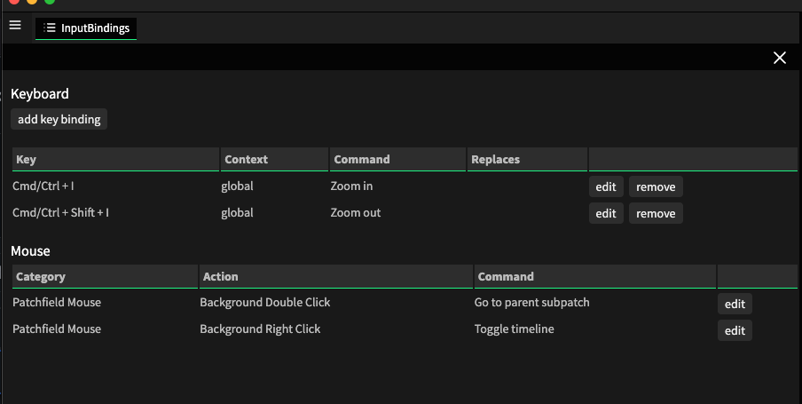
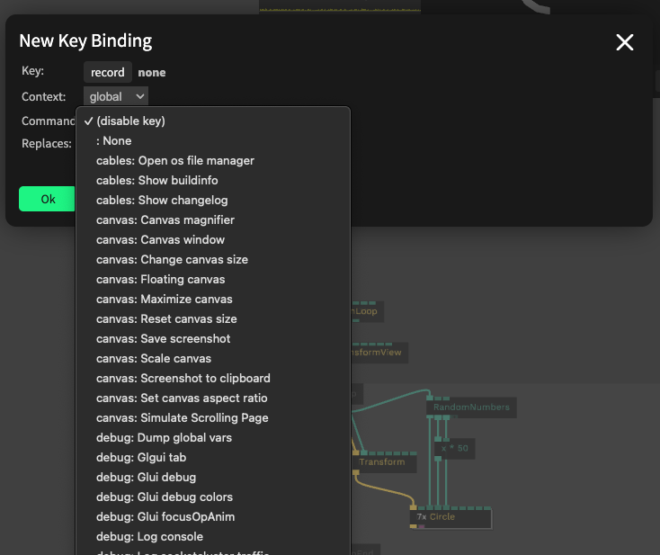

# Custom Key Bindings

You can assign your own keyboard shortcuts to any command or customize existing ones.

Open **Keybindings** in the editor menu, or open the command palette (`[mod] + p`) and enter `Keybindings`.

## Add a key binding

Click **add key binding**:

- **Key:** click **record** and press the key, with modifiers if you like (`[mod]`, `[shift]`, `[alt]`)
- **Context:** where the key works: `global` everywhere, `patch` only in the patch field, `timeline` only in the timeline
- **Command:** the command to run. Choose `(disable key)` to turn a key off.
- **Replaces:** the built-in shortcut that your binding replaces, if there is one

Custom bindings are saved with your user settings. Use **edit** or **remove** in the list to change them.

## Mouse

In the **Mouse** section you can choose which command runs on a double click or right click on the patch field background.

See also: [Keyboard Shortcuts](../../0_howtouse/keys/keys)
