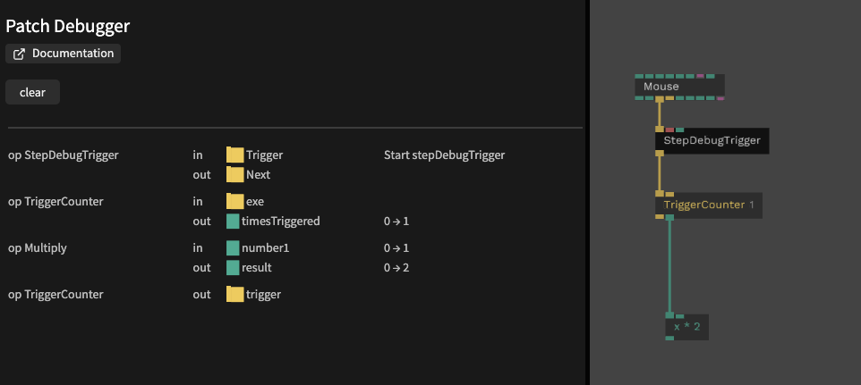

# Step Debugger

The step debugger shows step by step what happens in your patch after a trigger or a value change: which ops run, which ports are triggered and how values change.

## Usage

1. Add `StepDebugTrigger` or `StepDebugNumber` where you want to start recording
   - `StepDebugTrigger`: put it into a trigger chain, it records everything that happens below it when it is triggered
   - `StepDebugNumber`: put it into a number connection, it records everything that happens when the number changes
2. Open **Patch Debugger** in the editor menu, or open the command palette (`[mod] + p`) and enter `Patch Debugger`

The list shows every step in order:
- the op name
- `in` or `out`, and the port
- for values: old value → new value

Use **clear** to empty the list.

## Tips

- Give the ops a `Title` to see in the list where a recording started
- Switch off `Active` to stop recording without removing the op
- Recording a trigger that runs every frame fills the list very fast: use it on triggers that happen once, like a button or a change or try to use TriggerOnce Operator

## Op links
- [StepDebugTrigger](/op/Ops.Debug.StepDebugger.StepDebugTrigger)
- [StepDebugNumber](/op/Ops.Debug.StepDebugger.StepDebugNumber)
