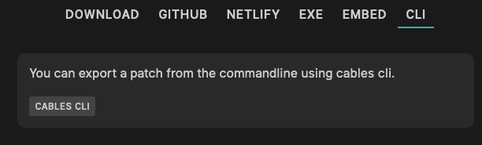

# Export to run patches on the commandline

Select the "Headless" option in the export dialog:



The resulting export will contain the patch, a package.json file and a run.js.

Unzip the download, open the directory in a terminal and run:

```sh
npm install
node run.js
```

## Prerequisites

- any current version of node/npm
- a patch that does not use WebGL or WebGPU
